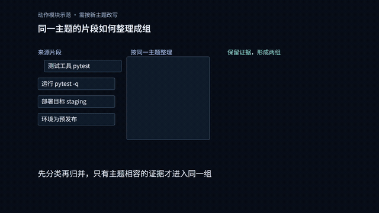
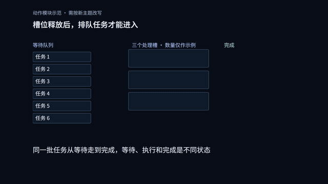
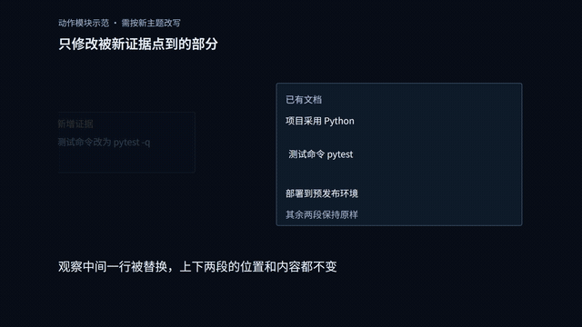
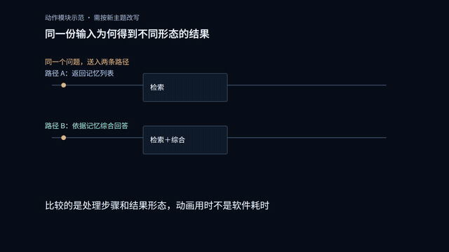

# story-motion-studio · 故事动效工坊

**把主题或 Markdown 材料做成讲得清楚的动态图解，交付可修改的 HTML 工程和 MP4**

默认采用当前认可的**暗色精细二维**表现：统一字体、暗底、蓝色处理、青色结果、琥珀色来源，按内容设计动作
适合流程教学、机制科普、系统对比和数据解释；默认无配音、中文屏幕文字、16:9横屏、1920×1080、30fps

## 先看动态效果

下面GIF截取自包内同一条48秒无声示范，经过缩小显示，展示连续变化而非静态截图
它们是动作能力示例，不是四条完整成片，也不表示换成任何资料都能直接套用

### 拆分归并

同一批对象拆开、移动并重新成组，适合文档整理、知识分类和数据预处理



可以这样提需求：`把课堂笔记拆成事实、问题和行动三类，保留来源，再展示归类结果`

### 队列并发

展示等待、槽位占用、完成释放与任务补位，适合任务调度和资源限制



可以这样提需求：`用六个任务和两个处理槽位，解释排队与并发，展示槽位怎样释放`

### 局部更新

新证据指向目标、替换局部值，其余信息保持原位，适合记忆更新和增量处理



可以这样提需求：`用偏好从喝咖啡变成喝茶的例子，说明只更新对应记录，其他记录保持不变`

### 双路对照

同一输入进入两条路径，按相同维度比较，适合方法、策略和系统对照



可以这样提需求：`同一份资料分别经过全文重写和局部更新，沿相同步骤比较，不编造性能数字`

[播放完整48秒无声示范](https://yangmuye814.github.io/story-motion-studio/examples/engineering-2d/demo.html) · [查看24项动作网页](https://yangmuye814.github.io/story-motion-studio/examples/motion-library/)

你不必手动指定接口，Codex根据资料含义选动作；缺少容量、真实数值或比较条件时先补信息，不用动画虚构结论

## 直接开始

在 Codex 发送下面内容，填写方括号即可

```text
使用 story-motion-studio 制作视频
主题或MD文件：[内容或文件路径]
观众：[谁来看]
看完能：[理解什么]
重点回答：[最关键的问题]
时长：[目标时长，或按全部资料安排]
资料：[使用我提供的材料，或先查可靠来源]
BGM：[提供音频或视频路径，或先不加音乐]
沿用默认暗色精细二维模板，不生成人物或环境场景
按内容选择拆分归并、队列并发、局部更新、双路对照等动作
先给讲稿、统一分镜和10秒连续样片，我确认后再制作整条
交付MP4、素材齐全的HTML工程、文稿分镜与资料来源
只使用免费工具，涉及收费先说明
```

没有参考视频也可以使用内置模板；新主题仍需要讲稿和连续样片检查，不保证任意题材一次达到高质量
只要文稿、分析或局部修改时直接说明，不会强制生成整片

## 默认风格与可选风格

| 风格 | 何时用 | 表现 |
|---|---|---|
| **暗色精细二维 · 默认** | 流程、机制、信息系统、比较 | 固定字阶与语义色，同一对象连续变化，局部展开与来源追踪 |
| 浅色精细二维 · 可选 | 希望更轻、更明亮 | 保留此前认可的16秒二维参考，明确选择后使用 |
| 黑金结构粒子 · 可选 | 结构、聚合、空间关系 | 黑金为主，少量独立结构与粒子表达状态，不强求三者同时出现 |

历史黑金讲解、三维结构、情境粒子三个方向及无声样例继续保留：[历史样例网页](https://yangmuye814.github.io/story-motion-studio/examples/)
[观看暗色模板与四类初始动作演示](https://yangmuye814.github.io/story-motion-studio/examples/engineering-2d/demo.html)

暗色参考和源码在 [主要模板目录](assets/templates/engineering-2d-v1/)，[10秒无声参考](assets/templates/engineering-2d-v1/preview.mp4) 展示已认可的风格
[四个初始动作组成48秒无声示范](assets/templates/engineering-2d-v1/modules-demo.mp4)，可在本地HyperFrames工作台预览；它们是可运行起点，不等于用户已认可新成片

## 24项动作自动选用与对象追踪

你不需要逐个手动调用，Codex先根据资料判断本镜要解释的关系，再检查动作前提，选用对应接口
例如有明确容量才演示队列，有同条件输入才做双路对照，有真实数值才画数值图，缺资料会指出缺什么

24项现在都提供统一视频接口MotionActions.add，调用同一条HyperFrames暂停时间线，绑定工程里真实的HTML对象
这表示有可调用的适配代码与示例，不表示不改参数和内容就能得到高质量新片

动作参数从统一分镜生成到HTML，检查会拦住两边配置不一致，避免维护两份参数

对象通过固定ID、来源、派生父对象与每镜状态追踪，上一镜结果进入下一镜时需明确交接
未注册对象、缺少节点、无说明的标签或状态变化、循环来源和应承接对象消失，会被结构检查拦住
章节切换可以明确重新开始，不需要伪造同一对象

[完整规则与调用示例](references/action-routing.md) · [24种网页动态展示](https://yangmuye814.github.io/story-motion-studio/examples/motion-library/)

## 动作按内容选

| 内容要解释什么 | 动作模块 | 观众能看到什么 |
|---|---|---|
| 一份输入怎样拆开、分类并重新整理 | 拆分归并 | 同一片段按主题移动并成组，来源仍保留 |
| 为什么任务要等、怎样并发处理 | 队列并发 | 槽位占用、完成释放、下个任务补位 |
| 为什么只修改这一处 | 局部更新 | 新证据指向目标，旧值替换，其余文字原位不动 |
| 两种方案的区别在哪里 | 双路对照 | 同输入明确分成两份，分别经过步骤，按同一维度比较 |

模块不必全部使用，也不是每镜轮流换特效
入场、描线、高亮只做辅助，不能用“卡片出现→连线→卡片出现”讲所有机制
详见 [模块用法与误用边界](references/mechanism-modules.md)

## HyperFrames 在里面做什么

```text
你的需求与资料
    ↓ Codex读取本技能和七个上游来源
讲稿＋唯一统一分镜 explanation.json
    ↓ 根据内容选动作，沿默认模板写HTML与暂停GSAP时间线
HTML工程＋字体、图形与音频素材
    ↓ HyperFrames中文工作台预览、修改、检查与逐帧绘制
连续画面＋音轨
    ↓ 本地FFmpeg编码
MP4候选 → 实际审片与修正 → 成片
```

HyperFrames 是本地实现、预览和导出工具，不是替你写出好文稿的视频生成模型
中文界面补丁随技能携带，使用本技能预览入口会应用到固定版本运行时，未覆盖的第三方诊断保留原文
新版初始化会直接复制暗色模板、字体、共享CSS和动作源码，建立视觉与资产锁；旧工程不会被自动改色或覆盖

## 首次安装：Windows

仓库地址：`https://github.com/yangmuye814/story-motion-studio`

**这台电脑已配置过：直接使用上面的提示词，不要重复安装**

**新电脑：分两步安装，目前没有经过验证的“七个来源＋HyperFrames全部一键安装”脚本**

已发布版本可用下面的远程命令。运行者应先查看本仓库安装脚本，再在PowerShell执行：

```powershell
$setup = Join-Path $env:TEMP ("story-motion-" + [guid]::NewGuid().ToString("N") + ".ps1")
Invoke-WebRequest "https://raw.githubusercontent.com/yangmuye814/story-motion-studio/main/install.ps1" -OutFile $setup
powershell -ExecutionPolicy Bypass -File $setup -InstallSystemTools
```

若脚本执行策略拦截，在已确认下载文件内容后，可用 `powershell -ExecutionPolicy Bypass -File <下载的脚本路径> -InstallSystemTools` 运行本次安装，不修改全局执行策略

已经下载或克隆仓库时，在仓库目录运行：

```powershell
powershell -ExecutionPolicy Bypass -File .\install.ps1 -InstallSystemTools
```

安装行为：

- 按 `upstreams.lock.json` 的固定提交下载七个来源，核对18个必需来源文件
- 下载 lemo 实际资料库，跳过上游大型媒体演示，保留代码和文档
- 创建独立 Python 虚拟环境，安装基础依赖；优先使用现有 Chrome，缺少时下载 Chromium
- 使用 imageio-ffmpeg 提供的 FFmpeg，不要求手工配置系统 PATH
- 写入本机路径配置，运行来源检查与真实浏览器绘图小检查
- 遇到已有技能目录或本机配置即停止，不覆盖，不执行自动升级

`-InstallSystemTools` 允许在缺少 Git/Python 时调用Windows自带的winget安装，可能出现系统安装提示；没有winget时需先手工安装Git和Python 3.10以上

只检查安装计划：`python install.py --check`，不联网、不写文件。高级路径选项见 `python install.py --help`，`--skip-runtime` 只装来源，不代表完整安装成功

安装范围是无配音代码动画路线，不下载语音克隆模型、不配置付费API。工具安装仍依赖网络，软件版本范围见 `requirements-install.txt`，上游固定版本见锁文件

## 安装后还要接入 HyperFrames

上面的旧安装器负责七个上游与基础运行环境，**尚不包含 HyperFrames 的全部新增依赖**
换电脑还需 Node.js、Chrome、FFmpeg/FFprobe、固定 `hyperframes@0.8.207` 运行时，以及 hyperframes、hyperframes-cli、hyperframes-registry、media-use 四个官方技能
详细配置见 [HyperFrames安装与使用](references/hyperframes.md)，不要把“复制本技能目录”当作已完成全部安装

第一步安装后，新开一个Codex对话，发送下面这段，让它检查并补齐环境

```text
检查 story-motion-studio 的制作环境并补齐免费依赖
先读取本技能 references/hyperframes.md
安装或定位 Node.js、Chrome、FFmpeg 和 FFprobe
在技能目录外安装固定版本 hyperframes@0.8.207
从 heygen-com/hyperframes 安装四个官方核心技能：
hyperframes、hyperframes-cli、hyperframes-registry、media-use
合并本机配置，保留已有字段，不隐式升级运行时
使用技能自带的中文界面补丁
检查七个必需来源是否完整
新建独立测试工程，实际完成中文预览和短片导出
报告安装位置、检查结果和仍缺少的项目
只使用免费本地功能，涉及收费先说明
```

完成标准：七个来源可读取、HyperFrames能运行、中文预览能打开、短片MP4实际导出并可播放
仅复制技能目录或doctor检查通过，都不等于实际导出已验证
运行时放技能目录外，不隐式升级，不自动启用付费云端、头像或语音克隆服务

## 日常使用：从资料到成片

| 步骤 | 你做什么 | Codex完成什么 |
|---|---|---|
| 提供资料 | 主题或MD路径、观众、理解目标、时长、音乐 | 梳理事实、覆盖范围与缺失信息 |
| 确认讲解 | 检查内容是否准确、是否遗漏 | 讲稿与唯一分镜，每镜明确对象变化、理解目标和承接 |
| 看连续样片 | 看10秒里能否读懂、运动是否帮助解释 | 同一HTML工程的连续样片，包含阅读停留和承接 |
| 扩展整片 | 回复通过，或提出具体修改 | 沿已确认的视觉和运动语言完成全片 |
| 检查交付 | 查看成片与音乐 | 分别检查内容、连续动作、可读性和实际导出 |

BGM请提供真实音频或视频路径，JPG缩略图没有音轨；没有素材时先不加，不继承演示音乐
工具采用免费本地路线，AI账户、外部素材可能另有费用，涉及收费先说明

### 修改已有视频

在原制作对话中说清时间段、问题和保留部分，例如

```text
修改当前工程的第20到35秒
文字太快，增加阅读停留
改为同一份输入经过两条路径的对照
保留其他镜头、风格和BGM
先输出这一段连续预览，通过后再重新导出整片
```

HTML保存文字、图形和时间线，HyperFrames运行它并逐帧导出，FFmpeg把连续画面与音轨编码为MP4
修改HTML后需要重新导出，旧MP4不会自动变化；分享可编辑工程时带齐整个目录和素材

### 安装或使用遇到问题

| 情况 | 处理方式 |
|---|---|
| GitHub下载失败 | 检查网络并保留报错，失败不算安装完成 |
| 提示已有目录或配置 | 防覆盖保护，让Codex检查差异，不要删除目录强行重装 |
| 新对话找不到技能 | 核对安装路径和SKILL.md，再重新打开Codex对话 |
| localhost打不开 | 让Codex检查预览服务是否运行、实际端口是什么 |
| MP4能播，HTML不能改 | 需要完整工程和制作环境，单个HTML不是工作台 |

## 七个来源与 HyperFrames 怎样分工

| 来源 | 负责的事 |
|---|---|
| wtt-code-animation-studio | 文稿信息、动作时长与阅读安排 |
| lemo-opuscar | 问题推进、故事结构与回扣 |
| huashu-art-motion | 对象前态、变化、后态与承接 |
| video-shotcraft | 镜头目的、切换理由与独立审片 |
| dashi-animationstyle | 字阶、语义色、构图和可读性 |
| mg-styles-15 | 参考真实示例，适配实际动效代码 |
| xilo-opus-video | 确定性取帧、输出检查与解码 |
| HyperFrames | 同一HTML工程的时间线、中文预览、检查与导出 |

七个上游是完整制作的必需来源，但不是七个模型，也不是七人各做一段再拼接
它们共同完善同一份分镜，记录真实引用、镜头与成果；不以调用数、特效数代替质量

## 怎么保证不再每次换一套

- 新工程默认装配同一暗色模板，固定字体、配色、字阶和动作入口
- 每镜声明为何选择该动作、哪个对象怎样变、何时停住阅读，并落实到HTML元素
- 共享模板资产有哈希锁，修改后须明确做风格或模块版本调整，不删锁假装没改
- 分别审查内容、连续动作、可读性、实际导出，技术通过不代表观众理解或音乐听感通过
- 先确认连续样片再扩展整片，新的主题和新动作仍需实际查看

锁定模板能减少波动，不能代替每条视频的内容设计与审片

## 交付与修改

交付 MP4、完整 HTML 工程、素材、文稿、分镜、来源及七项实际贡献说明
MP4直接播放；HTML工程必须保留完整目录，在HyperFrames中打开和修改，不能只双击一个HTML就当成工作台
改文字或代码后需要重新导出，旧MP4不会自动变化

见 [运行和修改工程](docs/editing.md) · [完整制作规范](references/shared-production.md)

## 能做与不能保证的事

擅长动态图形、文字、图表和独立结构解释，不保证逼真实拍、人物舞蹈或动物运动
默认不生成人物或环境场景，不追求三维材质，不用图片轮播和整屏大字代替讲解
本地工具采用免费方案，AI账户和外部素材可能另有费用，收费先说明
BGM按本次提供的真实素材准备，不继承样片音乐，不保证素材具备公开再分发权

## 文件导航

- [AI执行入口](SKILL.md) · [安装与迁移](docs/setup.md)
- [风格选择](references/approved-styles.md) · [动作模块](references/mechanism-modules.md)
- `assets/templates/engineering-2d-v1/`：默认风格、参考、字体、动作与可运行HTML
- `assets/styles/`、`examples/`：可选历史三套风格与样例
- `assets/studio-zh/`：中文界面适配
- `scripts/`：初始化、接入、检查与导出；重运行时不装进技能目录

当前v7已提供24项统一动作接口、内容关系选用规则和跨镜对象追踪，新工程启用新契约，旧工程不自动改变
